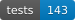
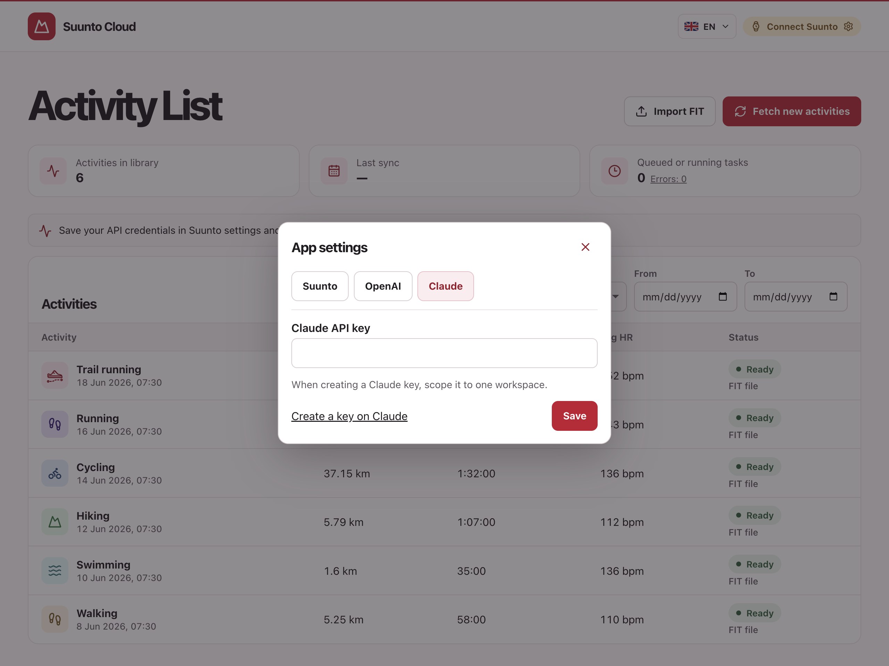
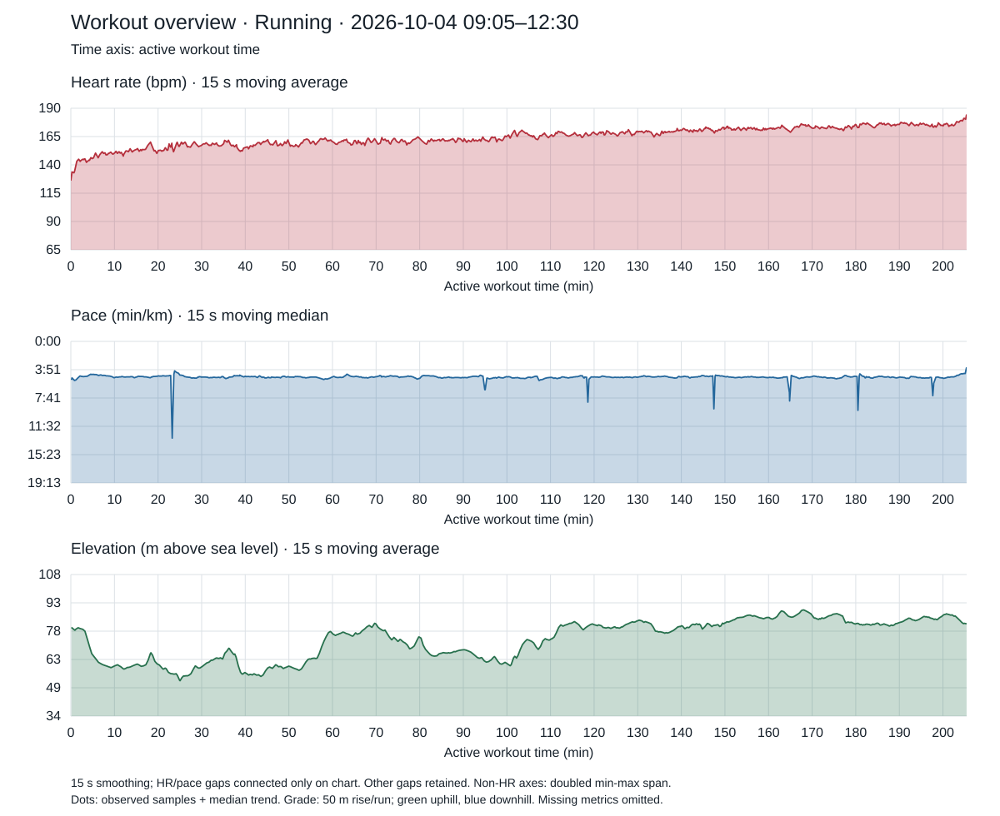
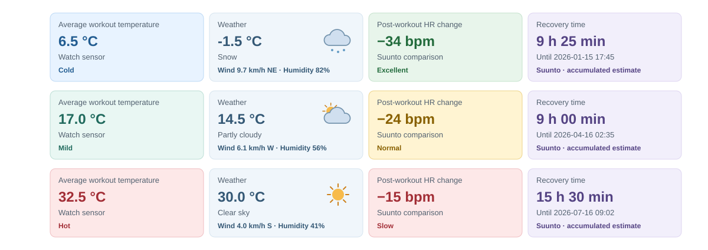
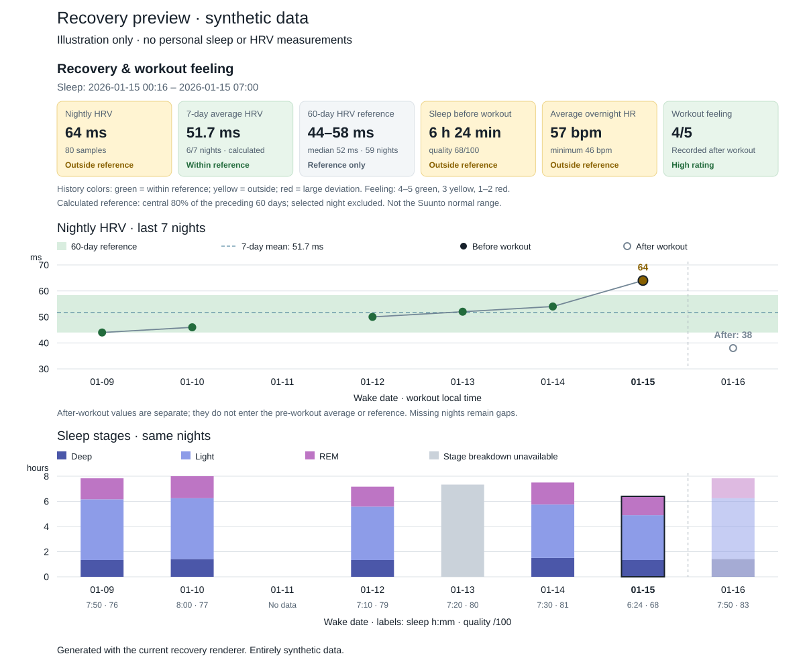

# Suunto Cloud Training Analysis

[](https://github.com/n0kit31/suunto-cloud-training-analysis/actions/workflows/ci.yml)
[](#tests)
[](CHANGELOG.md)
[](LICENSE)
[](#requirements)
[](Dockerfile)
[](docs/docker.md)

A local web app and CLI for analyzing FIT files and downloading workouts from
Suunto Cloud API. The web app lets you import FIT files, browse your activity
library, and open interactive charts. An approved Suunto API application enables
cloud synchronization. The CLI also exports GPX and creates JSON and Markdown
reports with laps, heart rate, pace, pauses, and running mechanics.

Data from the official Suunto MCP can be added through an external integration.
The current tools download data from Cloud API; this repository has no MCP client.

## Contents

- [Highlights](#highlights)
- [Independence and API access](#independence-and-api-access)
- [CLI quick start with Docker](#quick-start-with-docker)
- [Local web app](#local-web-app)
- [Web app screenshots](#web-app-screenshots)
- [Marathon example](#example-analysis-marathon)
- [Synthetic chart previews](#synthetic-chart-previews)
- [Project structure](#structure)
- [Requirements](#requirements)
- [Local setup](#local-setup)
- [Time zones](#time-zones)
- [Usage and commands](#usage)
- [Docker reference](#docker)
- [Tests and CI](#tests)
- [Contributing](#contributing)
- [Releases and changelog](#releases)
- [License](#license)

## Highlights

- Browse a local workout library with sport and date filters, background analysis, and optional AI interpretations.
- Page through workout history and fetch original FIT files with automatic OAuth refresh.
- Import single-session FIT files offline and save a separate report.
- Analyze pace, heart rate, power, laps, pauses, running mechanics, and SuuntoPlus fields.
- Generate Markdown/JSON reports and offline HTML charts with a synchronized cursor, drag-to-zoom, lap selection, and SVG downloads.
- Compare available sessions from the same week by distance, active time, and HR-based TSS.
- Add optional sleep/HRV history, sleep stages, historical reference colors, and recorded workout feeling.
- Run in Docker while keeping credentials and raw workout files outside the image and Git.

## Independence and API access

This is an independent project, not affiliated with, endorsed by, or sponsored
by Suunto Oy. Suunto is a trademark of Suunto Oy.

Connecting to Suunto Cloud API requires an approved API application and
credentials supplied by the installation's operator. The operator is
responsible for obtaining any required API agreement, subscriptions, and
approvals, and for complying with Suunto's API terms and rate limits. User
consent through OAuth does not replace these requirements. No shared
application credentials or API access are provided with this repository.

Suunto's [API Zone](https://apizone.suunto.com/) describes access for approved
companies and organizations providing tools, apps, or services to a public
audience, and states that API access is not offered for personal use. A Suunto
account or watch alone does not grant Cloud API access. Review the
[official FAQ](https://apizone.suunto.com/faq) before setting up an installation.

The project's GPL license grants rights to this code; it does not grant access
to Suunto services or rights to Suunto trademarks.

## Quick start with Docker

You need Git, Docker with Compose, and a Suunto API Zone application with a
subscription approved for your intended use. See
[API access requirements](#independence-and-api-access). Python and Node.js
are included in the image.

```sh
git clone https://github.com/n0kit31/suunto-cloud-training-analysis.git
cd suunto-cloud-training-analysis
export SUUNTO_UID="$(id -u)" SUUNTO_GID="$(id -g)"
mkdir -p .local ../reports ../visualizations
cp -n config.example.json config.json
```

Set your application's `client_id` and your local IANA `timezone` in
`config.json` (for example, `America/New_York`). The redirect URI must match
`http://127.0.0.1:8765/callback` in API Zone. Then build and authorize:

```sh
docker compose build
docker compose run --rm --service-ports suunto oauth
docker compose run --rm suunto access --configure
docker compose run --rm -T suunto sync --date 2026-01-15 --analysis --brief
```

Replace the example date with your workout date. Add `--charts` to the last
command to generate charts. Reports are saved in `../reports/` and charts in
`../visualizations/`. See the [Docker guide](docs/docker.md) for details.

## Local web app

Start the web app from the repository root, then open `http://127.0.0.1:3000`.
Set `SUUNTO_TIMEZONE` to an IANA time zone before starting to use local time in
the activity list and charts. The following example uses `Europe/Warsaw`.

```sh
export SUUNTO_UID="$(id -u)" SUUNTO_GID="$(id -g)"
export SUUNTO_TIMEZONE=Europe/Warsaw
docker compose up -d --build web worker
```

### Using the library

1. Select **Import FIT** to add one or more single-session FIT files. You can
   use this workflow offline with the local app.
2. To add Suunto Cloud activities, enter your approved API credentials in
   **App settings → Suunto** and complete the OAuth sign-in. The first successful
   sync covers 30 calendar days. Use **Fetch new activities** to import new
   workouts and refresh changed records. The app shows progress and reports the
   outcome of a sync started from the current page. Click **Errors** to inspect
   or dismiss failed jobs. [Suunto authorization steps](docs/web.md#connect-suunto)
3. Filter the **Activity List** by sport or date and open a workout to see its
   metrics, laps, and charts. The chart shows the watch model when the FIT file
   contains a supported device name. Use the language menu to switch from
   English to Polish.
4. For an optional AI interpretation, save an API key in **App settings → OpenAI**
   or **Claude**. In an analyzed workout, select **Interpret activity** under the
   provider you want to use. Only that action sends selected numeric metrics and
   laps to the provider, and each provider's result is saved separately. You can
   remove saved keys from the app settings. [AI configuration and data handling](docs/web.md#optional-ai-interpretation)

### How it runs

React and Fastify serve the interface and local API. A separate worker runs
the existing Python analyzer in the background. A Docker volume holds SQLite,
original FIT files, and generated charts, so the library survives a container
restart. The worker stores credentials in its private auth mount. [Storage and
configuration guide](docs/web.md#storage-and-performance)

### Web app screenshots

These screenshots use synthetic FIT workouts. They show the activity list,
a trail-run overview, and the provider settings.


<details>
<summary>Workout overview and application settings</summary>




</details>

## Example analysis: marathon

A real marathon recording shared with the project owner's permission, analyzed
from Suunto Cloud API summaries and FIT samples. Distance and time are watch
measurements; the official race result has not been verified.

| Metric | Result |
| --- | --- |
| Recorded distance | 42.320 km |
| Active time | 3:25:27 |
| Average pace | 4:51.3 min/km |
| Average / maximum heart rate | 165 / 186 bpm |
| Average / normalized power | 285.6 / 286.1 W |
| Ascent / descent | 134.9 / 133.6 m |
| Average cadence | 189.5 steps/min |
| Average ground contact time | 240.4 ms |
| Training stress score | 324.264 (HR method) |
| Peak training effect | 5.0 |
| Timer pauses | None |

The SVG below is exported from the current HTML chart and shows all nine workout
panels and the recorded workout feeling.



**Interpretation.** The first 21 km took 1:41:36.2 and the next 21 km took
1:42:29.7, a difference of 53.5 seconds. These are equal-distance watch
segments. Average heart rate rose from 157.7 to 171.3 bpm across those segments,
while average power stayed close at 286.4 and 284.4 W. Pace remained broadly
steady late in the race, with the final 320 m covered in 1:21.0 (4:13.1 min/km).
The recording shows a sustained effort and a faster finish; it does not
establish the cause of the heart rate increase.

Heart rate, elevation, and power use centered 15 s moving means; pace and speed
use 15 s medians. Mechanics show observed dots with a median trend. Heart rate
and pace gaps are connected linearly for display only. Heart rate uses a
65–190 bpm axis; other axes double the displayed min–max span. Charts show active
workout time with 10-minute ticks, and summary statistics use source measurements.
Step length and terrain grade are estimates; see [chart methods](#usage).
The example includes no GPS coordinates, account or workout identifiers, or raw
workout files.

## Synthetic chart previews

### Workout conditions and recovery time

Three fictional workouts show the blue, teal, and red temperature tiles. Each
row also shows an illustrated weather tile, Suunto's post-workout heart-rate
comparison, and the estimated local recovery deadline.



### Nightly HRV, SpO₂, and sleep stages

This example shows the recovery tiles, seven-night HRV history, calculated
60-day reference band, and sleep stages. The SpO₂ row follows the same wake
dates as HRV. A separate marker identifies the night after the workout, which
is excluded from the pre-workout statistics. Missing observations remain gaps.
See [sleep and HRV context](#sleep-and-hrv-context) for calculation details.



## Structure

Code in `suunto_cloud/` is organized by responsibility:

| Directory | Responsibility |
| --- | --- |
| `authentication/` | OAuth, credentials, and authenticated requests |
| `downloads/` | Workout summaries and FIT downloads |
| `analysis/` | Metric calculations and analysis packet preparation |
| `reporting/` | Markdown/JSON reports, interactive HTML charts and SVG exports |
| `synchronization/` | Download, analysis, and reporting coordination |
| `storage/` | Configuration paths and secure local storage |
| `fit/` | Node.js FIT decoder and GPX exporter |

Tests in `tests/` follow the same structure. Calculations are independent of API
access and file storage. Commands are handled by `suunto_cloud/cli.py`.

## Requirements

For local execution:

- Python 3.9+ on macOS or Linux, with time zone data available for the user's local time zone.
- Node.js and the `fit-file-parser` package for FIT decoding.
- Your own approved OAuth application and API subscription in [Suunto API Zone](https://apizone.suunto.com/how-to-start), subject to the [API access requirements](#independence-and-api-access).

## Local setup

Run commands from the repository directory. Install FIT decoder dependencies
and create the local configuration:

```sh
npm ci --ignore-scripts --no-audit --no-fund
cp -n config.example.json config.json
```

Enter your `client_id` and check `redirect_uri` in `config.json`.
The default callback is `http://127.0.0.1:8765/callback`; it must match the
application settings in API Zone. Then authorize your account and configure
credentials:

```sh
python3 -m suunto_cloud oauth
python3 -m suunto_cloud access --configure
```

Enter credentials interactively using hidden input. Local configuration,
tokens, and downloaded data are excluded from Git and the Docker build context.

## Time zones

Workout dates, local timestamps, filenames, and reports use the time zone of
the person running the analysis. The selection order is:

1. The `SUUNTO_TIMEZONE` environment variable.
2. The `timezone` setting in `config.json`.
3. The `TZ` environment variable.
4. The local system time zone when no explicit setting is provided.

Use an IANA time zone name. For example:

```json
{
  "client_id": "YOUR_SUUNTO_CLIENT_ID",
  "redirect_uri": "http://127.0.0.1:8765/callback",
  "timezone": "America/New_York"
}
```

Set `timezone` to `null` to use the environment or system default. Conversions
apply the offset and daylight saving rules for the workout date.

For Docker, set `timezone` in `config.json` or export `SUUNTO_TIMEZONE` or `TZ`
before running Compose. Both environment variables are passed to the container;
without them or a configured zone, the container uses its own system zone,
normally UTC. Regenerating charts from a saved report retains that report's
recorded local timestamps.

## Usage

Download and analyze workouts from a selected date:

```sh
python3 -m suunto_cloud sync --date 2026-01-15 --analysis --brief
```

Dates use the [user's selected time zone](#time-zones); `--date` may be repeated.
Add `--charts` to generate a chart. Raw data and analyses are in `.local/`,
reports in `../reports/`, and charts in `../visualizations/`.
Charts use active workout time: pauses are removed from the time axis and have
no separate markers. Heart rate uses a fixed 65–190 bpm axis (overridable with
`charts --hr-range MIN MAX`). Other axes double the displayed min–max span,
with minimum spans for flat data and nonnegative bounds for unsigned metrics.
Smoothing uses centered 15 s windows and resets at pauses and measurement gaps
over 2 s. Heart rate and pace gaps are connected linearly on the chart only;
other measurement gaps remain visible. Source data and statistics are unchanged.

Only metrics with available samples are included:

| Metric | Presentation and smoothing |
| --- | --- |
| Heart rate / elevation | Filled line, 15 s moving mean |
| Pace / speed | Filled line, 15 s moving median; min/km / km/h |
| Running power | Filled line, 15 s moving mean, W |
| Cadence | Observed dots with a 15 s median trend; steps/min for running/walking, rpm otherwise |
| Ground contact | Observed dots with a 15 s median trend, ms |
| Estimated single step length | Dots with a 15 s median trend; `30 * speed_mps / cadence_cycles_per_min`, using simultaneous positive samples |
| Estimated terrain grade | Signed area around zero: green uphill, blue downhill; local rise/run over up to 50 m, then 15 s mean |

Dot plots preserve observed variation without filling the area under it.
Their axis ranges include the raw dots, and sample reduction preserves extrema.
Grade uses actual endpoint observations within ±25 m, at least 20 m and three
distinct distance samples. Windows do not cross pauses, missing inputs,
distance resets, or recording/stationary gaps over 2 s. The grade axis includes
zero. It is an estimate of local slope, rather than a surveyed measurement.
Reports use decimal points. The main chart file ends in `-overview.html`; a
matching `-overview.svg` is saved for static export. HTML files contain their
SVG, styles, JavaScript and chart observations, so they work offline without
external assets or a server. Move over any workout panel to synchronize the
vertical cursor and readouts across all workout panels; click or tap to pin
the position while scrolling. Use the time slider for keyboard selection,
Escape or Clear to reset, and Download SVG for a static copy. Readouts use
the nearest available smoothed observation within one second, without
interpolating measurement gaps. Every workout time axis has fixed 10-minute
ticks. Sleep/HRV retain their separate calendar axis.

Drag horizontally across a workout panel to zoom all workout charts, or use
the lap picker to inspect recorded laps or guided workout steps. The selection
shows active time, distance, pace, average and maximum heart rate, and average
power where available. Lap values come from FIT lap summaries. Drag selections
use recorded active samples, with pace and distance measured between the first
and last available distance observations inside the selection. **Full workout**
resets the view. **Download SVG** exports the full workout.

Each HTML page also includes a short English workout summary and a comparison
with available sessions from the same Monday–Sunday week in the workout's time
zone. It shows distance, active time and HR-based TSS totals, highlights the
selected session, and keeps walking/hiking separate from running. Other TSS
methods are not added to HR-TSS. Repeated faster/slower kilometre splits are
described from the recorded laps, without assuming they were programmed intervals.
Synchronization uses the workout list already downloaded. Offline chart
regeneration combines the saved weekly context, local reports and the optional
workout-list cache, without API requests. Weekly totals describe available
records and do not assert that the entire week or history is complete.
The chart title includes the activity type and recorded start–end times, for example
`Workout overview · Trail running · 2026-01-15 08:00–09:10`.
If the workout crosses midnight, both dates are shown. An unavailable end time
is left out rather than reconstructed from active time.
Labels use [Suunto App activity IDs](https://aspartnercontent.blob.core.windows.net/apizone/docs/Activities.pdf),
then an explicit activity name or FIT sport/sub-sport when the ID is not mapped.
Sync pages back through the Monday of the earliest requested date in the
configured time zone. Use `workouts --all` for all pages or `workouts --since DATE`
to list workouts started on or after a local calendar date. An interrupted or
stalled page traversal leaves the previous list cache available.

New Cloud FIT, GPX, report and chart filenames combine the local start time
with a workout fingerprint. Use the paths returned by `sync` or `track`.
`charts` also accepts timestamp-only reports saved by earlier releases.
After an incomplete sync, `.local/sync.json` records completed outputs and
the stage that failed. A concurrent sync for the same project exits before
modifying the manifest.

Regenerate an existing chart without downloading data again:

```sh
python3 -m suunto_cloud charts ../reports/suunto-2026-01-15-080000.json
```

Reports add the average temperature from the watch sensor and Suunto's recovery
time estimate when available. The estimate uses accumulated recovery when Suunto
reports it and falls back to the workout estimate. The local end date and time
are calculated from the recorded workout finish. Charts use blue below 10 °C,
teal from 10 °C up to 30 °C, and red from 30 °C for the sensor reading.
The separate weather tile shows available weather, wind and humidity. The report
shows Suunto's rated post-workout HR change, and its tile uses the comparison
rating to color the result.

### Sleep and HRV context

Analyses automatically read `.local/sleep.json` when present. This private
snapshot comes from the official Suunto MCP or an authorized Suunto 247 API
integration; the CLI does not connect to the agent's MCP session or fetch sleep
with the workout endpoint. Refresh the snapshot before analyzing recent workouts.
Its format is `{"source": "official_suunto_mcp", "retrieved_at_utc": "…", "data": [...]}`,
where `data` contains the unmodified Suunto 247 `timestamp` / `entryData` samples.
Keep this file in `.local/`, excluded from Git and Docker images. The source
and retrieval timestamp are retained in the report.

Use `sync --analysis --sleep-data PATH` for another snapshot, or add context to
an existing chart without downloading FIT again:

```sh
python3 -m suunto_cloud charts ../reports/suunto-2026-01-15-080000.json --sleep-data .local/sleep.json
```

The chart header and report show the last completed non-nap sleep within 24 h
before the workout: nightly HRV, seven-day mean and coverage, sleep duration and
quality, average/minimum nighttime HR, and the highest overnight SpO₂ reported
by Suunto. The report also includes the highest SpO₂ for the after-workout night
when available. Suunto's `MaxSpo2` fraction is converted to a percentage and
stored as `spo2_max_pct` in the report JSON. Complete snapshots are deduplicated
by `SleepId`. Sleep duration uses the sum of deep/light/REM stages when all are
available, otherwise the reported `Duration`. Nighttime HR is not daytime
resting HR. Missing values remain missing, and fewer than three observed nights
do not produce a seven-day mean.

With at least 14 nights in the preceding 60 calendar days, the header also shows
our own descriptive HRV reference: the median and 10th–90th percentiles, excluding
the selected night. These are **not Suunto's normal range or readiness status**.
Each local wake date contributes at most one main sleep. Pre-workout statistics
exclude nights ending after workout start. The first main sleep starting within
24 h after workout end is described separately in the report, with no claim that
the workout caused a change. Regenerating charts preserves their saved context;
`--sleep-data` explicitly recomputes it from the supplied snapshot.

Charts also include two calendar-based panels above the workout: nightly HRV
over the seven-day window, and stacked deep/light/REM sleep durations for the
same nights. The selected pre-workout night is highlighted. The HRV panel shows
the calculated 60-day band, seven-day mean, and recorded SpO₂ maxima aligned
with the same wake dates. A separately marked after-workout
night may extend the calendar axis; it never enters the pre-workout statistics.
Missing nights leave gaps, and a missing stage breakdown uses a gray total-sleep
bar instead of invented stages. Sleep labels show duration and quality /100.

Tiles use **calculated historical deviation**, with visible text labels as well
as color. Each metric needs at least 14 observed nights in the preceding 60 days:

- Green: within its 10th–90th percentile reference band.
- Yellow: outside that band, within extended outer limits.
- Red: beyond the outer limits, labeled "Large deviation".
- Gray: reference-only tile, missing metric, or insufficient history.

Each outer limit extends its reference edge by the larger of half the band width
or 10% of the historical median. Both unusually low and high values count as
deviations; the colors are not Suunto readiness or medical alerts. Nightly HRV
and the seven-day mean are assessed separately against the HRV reference. The
sleep tile uses the worse available comparison of duration and quality, and
overnight HR uses its own history. The report and JSON retain these rules and
the separate metric statuses. These are explicit display rules, not a recreation
of Suunto's unpublished status algorithm.

A separate **Workout feeling** tile shows the subjective rating recorded in
Suunto after the workout: 4–5 green, 3 yellow, 1–2 red, and missing/invalid ratings
gray. Its colors follow the 1–5 rating, independently of historical recovery
comparisons. The tile also works without sleep data; no rating is inferred from
HRV, pace, or heart rate. The report includes the recorded feeling as well.

Help: `python3 -m suunto_cloud --help` or `python3 -m suunto_cloud sync --help`.
The legacy `python3 sync.py ...` command still works through a compatibility wrapper.

| Command | Purpose |
| --- | --- |
| `sync --date YYYY-MM-DD --analysis --brief` | Download fresh data and produce a concise analysis |
| `sync --date YYYY-MM-DD --analysis --brief --charts` | Also generate charts |
| `charts PATH_TO_REPORT.json` | Regenerate charts from saved data without API access |
| `workouts` | Download the latest workout-list page |
| `workouts --all` / `workouts --since YYYY-MM-DD` | Page through all workouts or list workouts started since a local date |
| `track --workout-key WORKOUT_KEY` | Download a recorded FIT and export GPX |
| `analyze PATH_TO_DECODED.json` | Analyze decoded FIT samples |
| `import-fit PATH_TO_WORKOUT.fit [--charts]` | Analyze a local single-session FIT file and save a separate report |
| `oauth` | Authorize the Suunto account |
| `access --configure` | Save credentials using hidden interactive input |

Run commands as `docker compose run --rm suunto COMMAND`, or as
`python3 -m suunto_cloud COMMAND` during local development.

Local FIT imports use only information in the file. Cloud fields such as TSS
and workout feeling remain unavailable, and charts require active timer
intervals and usable measurements. The report and chart filenames include a
FIT fingerprint so a synced workout with the same start time has its own files.
See the [Docker import instructions](docs/docker.md#import-a-local-fit-file).

## Docker

The Dockerfile includes the Python/Node.js runtime and FIT decoder dependencies.
Compose mounts configuration and data outside the image. See the
[Docker instructions](docs/docker.md) for directory setup, UID/GID, and authorization.

```sh
docker compose build
docker compose run --rm suunto sync --date 2026-01-15 --analysis --brief
```

## Tests

The [CI workflow](.github/workflows/ci.yml) runs the offline suite on Python 3.9
and 3.13 with Node.js 24, and separately builds and verifies the Docker images.
It runs on pushes to `main` and `develop`, version tags (`v*`), pull requests,
and manual dispatch. The CI badge
reflects the GitHub Actions result and becomes available after the first run.

```sh
python3 -m unittest discover -s tests -t . -v
```

Tests use synthetic data and do not require Suunto credentials or API access.
The test-count badge reports discovered test cases; CI checks that it matches
the suite. After adding or removing tests, regenerate it with:

```sh
python3 scripts/update-test-badge.py
python3 scripts/update-test-badge.py --check
```

The [Docker image checks](scripts/docker/test-image.sh) also run the suite in
the container, exercise the CLI without network access, and verify that the
final image contains no private configuration, runtime data, or test files.

## Contributing

Use [GitHub Issues](https://github.com/n0kit31/suunto-cloud-training-analysis/issues)
for bug reports and suggestions, or submit a pull request with a focused change.
Include reproduction steps and the relevant command when reporting a problem.

Keep code, comments, documentation, and generated labels in English. Use
synthetic data for tests and examples; the marathon illustration above is an
explicitly approved exception. Before submitting, run the test suite and check
the test-count badge. Keep credentials, OAuth tokens, raw workout files, and
personal reports out of commits and issue attachments.

## Releases

[**1.3.0**](https://github.com/n0kit31/suunto-cloud-training-analysis/releases/tag/v1.3.0)
adds nightly SpO₂ alongside HRV, chart tiles for workout conditions and recovery,
and workout-specific filenames. See [CHANGELOG.md](CHANGELOG.md) for release notes,
and run `python3 -m suunto_cloud --version` to check the installed version.

Stable releases are maintained on `main` and identified by version tags such
as `v1.3.0`. Release changes are committed on `develop`, merged into `main`,
and tagged from `main`. Development of subsequent iterations continues on `develop`.

## License

Copyright (C) 2026 Marcin Krzyżanowski.

This project is licensed under **GNU GPL v3 or later** (`GPL-3.0-or-later`).
See [LICENSE](LICENSE) for the full text.

Dependencies retain their own licenses. See
[THIRD_PARTY_NOTICES.md](THIRD_PARTY_NOTICES.md) for dependency licenses and
the location of the original notices included in the Docker image.
