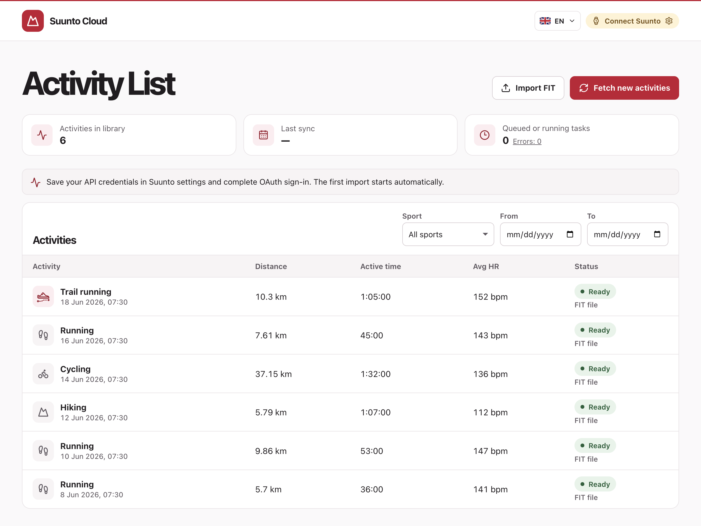
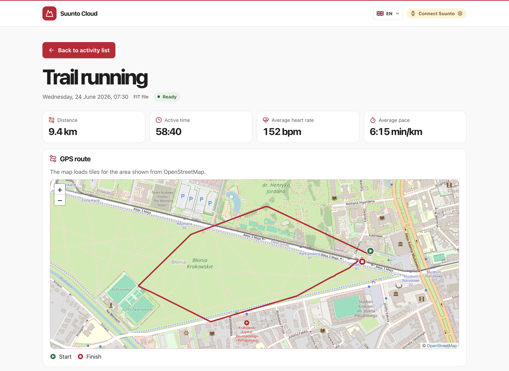
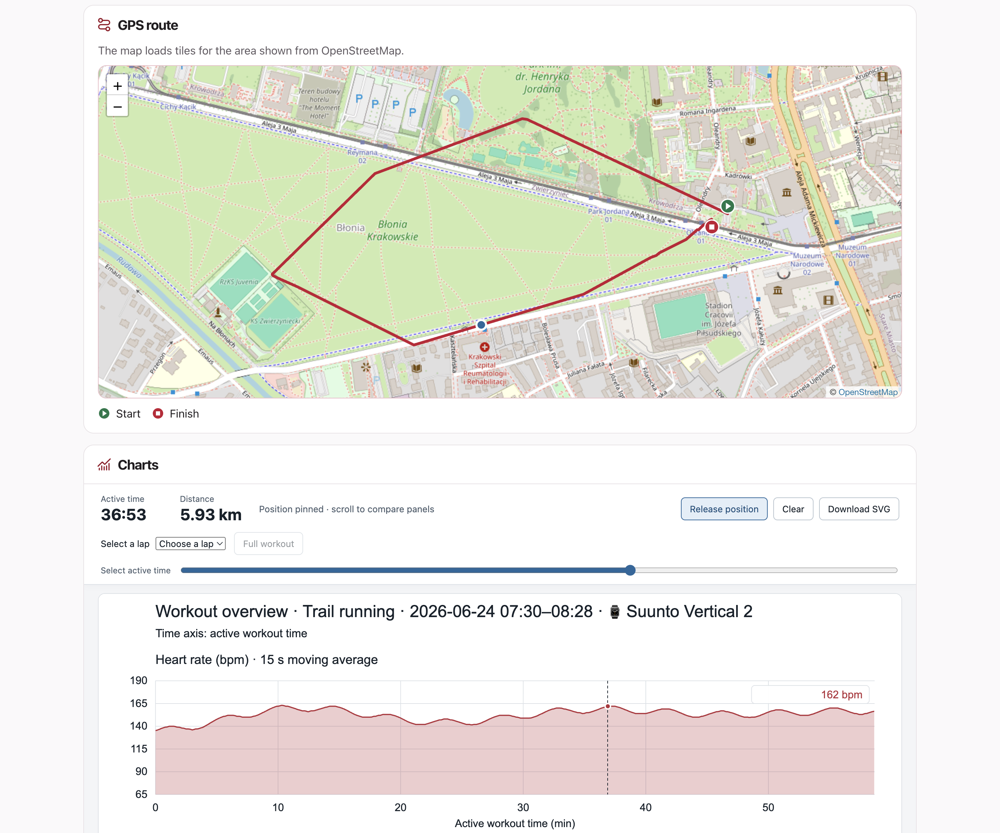

# Suunto Cloud Training Analysis

[](https://github.com/n0kit31/suunto-cloud-training-analysis/actions/workflows/ci.yml)
[](docs/cli.md#tests)
[](CHANGELOG.md)
[](LICENSE)
[](Dockerfile)
[](web/package.json)
[](web/package.json)
[](docs/web.md#storage-and-performance)
[](web/package.json)
[](docs/docker.md)

Analyze Suunto workouts locally with a web app and CLI. Import single-session
FIT files, explore routes on a map with synchronized charts, and sync Suunto
Cloud activities with approved API access.

## Local web app

From the checkout, run the following commands with Docker Compose installed.

```sh
export SUUNTO_UID="$(id -u)" SUUNTO_GID="$(id -g)"
mkdir -p "${SUUNTO_WEB_AUTH_DIR:-.}/.local"
docker compose up -d --build web worker
```

Open `http://127.0.0.1:3000`.

- **Import FIT** works offline. Filter the library by sport or date and open
  activities to see metrics, laps, charts, and the watch model when available.
- **GPS routes** appear above the charts. Move the chart cursor to see the
  corresponding point on the route. The OpenStreetMap basemap uses an internet
  connection and the route is drawn from the local FIT.
- **Suunto sync** imports the most recent 30 calendar days on the first
  successful sync. Later syncs fetch new and changed workouts. Use **Last sync
  result** and **Errors** to check the outcome.
- **OpenAI and Claude** provide optional interpretations on request. Each
  provider receives selected metrics and lap summaries when you choose it.
- **English and Polish** are available from the language menu.

The activity library is stored in a local Docker volume. The web worker and CLI
share private Suunto authorization. [Setup, storage, and AI settings](docs/web.md)

### Web app screenshots

The screenshots use synthetic FIT workouts and routes. Map data ©
[OpenStreetMap contributors](https://www.openstreetmap.org/copyright).





| Chart cursor on the route | App settings |
| --- | --- |
|  |  |

## CLI

The CLI runs on Node.js 24 inside Docker. Follow the [Docker setup guide](docs/docker.md#setup)
to prepare the mounted directories before running these commands from the checkout.

| Task | Command |
| --- | --- |
| Build the CLI image | `docker compose build suunto` |
| Show help | `docker compose run --rm suunto --help` |
| Import a local FIT file with charts | `docker compose run --rm -T suunto import-fit /app/suunto-cloud/.local/workout.fit --charts` |
| Download and analyze a day with charts | `docker compose run --rm suunto sync --date 2026-01-15 --analysis --brief --charts` |

Place `workout.fit` in `.local/` for the offline example. For cloud sync,
replace the example date with your workout date and follow the [Suunto authorization guide](docs/docker.md#authorization).
Reports go to `../reports/` and charts to `../visualizations/`.

For local development, install dependencies with `npm ci --ignore-scripts`
and show help with `node suunto_cloud/cli.mjs --help`.

## Documentation

- [Docker setup, OAuth, and FIT import](docs/docker.md)
- [CLI commands, time zones, and recovery metrics](docs/cli.md#usage)
- [Marathon example and synthetic charts](docs/cli.md#example-analysis-marathon)
- [Tests and contributing](docs/cli.md#tests)
- [Changelog](CHANGELOG.md)

## Independence and API access

This project is independent of Suunto Oy. Cloud sync requires an approved OAuth
application and API subscription. API access is subject to Suunto's terms and
eligibility requirements for companies and organizations. Suunto is a trademark
of Suunto Oy. [Suunto API Zone FAQ](https://apizone.suunto.com/faq)

## License

Copyright (C) 2026 Marcin Krzyżanowski.

[GPL-3.0-or-later](LICENSE) · [Third-party notices](THIRD_PARTY_NOTICES.md)
