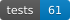
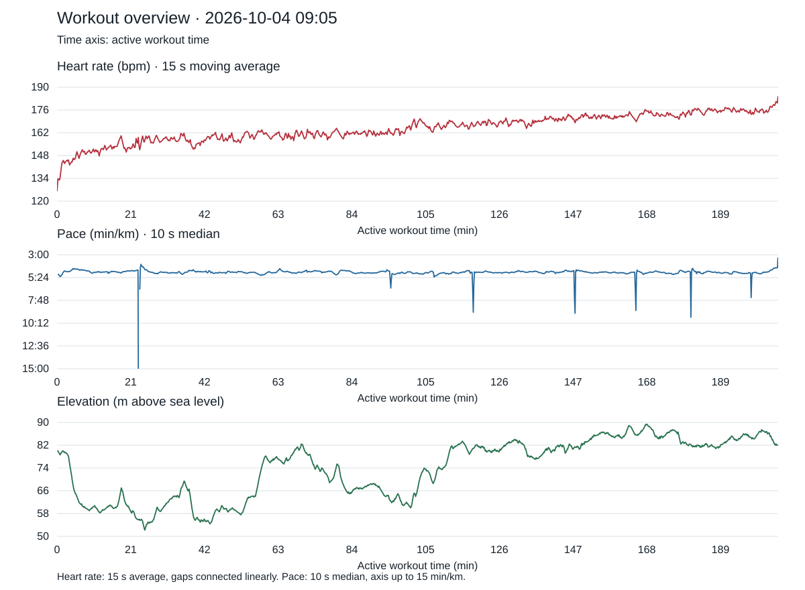

# Suunto Cloud Training Analysis

[](https://github.com/n0kit31/suunto-cloud-training-analysis/actions/workflows/ci.yml)
[](#tests)
[](CHANGELOG.md)
[](LICENSE)
[](#requirements)
[](Dockerfile)
[](docs/docker.md)

A CLI for downloading data from Suunto Cloud API and analyzing FIT files.
Supports OAuth with automatic token refresh, GPX export, and JSON and Markdown
reports with laps, heart rate, pace, pauses, and running mechanics. SVG charts
are optional.

Data from the official Suunto MCP can be added through an external integration.
The current tools download data from Cloud API; this repository has no MCP client.

## Contents

- [Highlights](#highlights)
- [Independence and API access](#independence-and-api-access)
- [Quick start with Docker](#quick-start-with-docker)
- [Marathon example](#example-analysis-marathon)
- [Project structure](#structure)
- [Requirements](#requirements)
- [Local setup](#local-setup)
- [Time zones](#time-zones)
- [Usage and commands](#usage)
- [Docker reference](#docker)
- [Tests and CI](#tests)
- [Contributing](#contributing)
- [Releases and changelog](#releases)
- [License](#license)

## Highlights

- Fetch workout summaries and original FIT files with automatic OAuth refresh.
- Analyze pace, heart rate, power, laps, pauses, running mechanics, and SuuntoPlus fields.
- Generate Markdown/JSON reports and portable SVG charts with smoothed heart rate.
- Run in Docker while keeping credentials and raw workout files outside the image and Git.

## Independence and API access

This is an independent project, not affiliated with, endorsed by, or sponsored
by Suunto Oy. Suunto is a trademark of Suunto Oy.

Connecting to Suunto Cloud API requires an approved API application and
credentials supplied by the installation's operator. The operator is
responsible for obtaining any required API agreement, subscriptions, and
approvals, and for complying with Suunto's API terms and rate limits. User
consent through OAuth does not replace these requirements. No shared
application credentials or API access are provided with this repository.

Suunto's [API Zone](https://apizone.suunto.com/) describes access for approved
companies and organizations providing tools, apps, or services to a public
audience, and states that API access is not offered for personal use. A Suunto
account or watch alone does not grant Cloud API access. Review the
[official FAQ](https://apizone.suunto.com/faq) before setting up an installation.

The project's GPL license grants rights to this code; it does not grant access
to Suunto services or rights to Suunto trademarks.

## Quick start with Docker

You need Git, Docker with Compose, and a Suunto API Zone application with a
subscription approved for your intended use. See
[API access requirements](#independence-and-api-access). Python and Node.js
are included in the image.

```sh
git clone https://github.com/n0kit31/suunto-cloud-training-analysis.git
cd suunto-cloud-training-analysis
export SUUNTO_UID="$(id -u)" SUUNTO_GID="$(id -g)"
mkdir -p .local ../reports ../visualizations
cp -n config.example.json config.json
```

Set your application's `client_id` and your local IANA `timezone` in
`config.json` (for example, `America/New_York`). The redirect URI must match
`http://127.0.0.1:8765/callback` in API Zone. Then build and authorize:

```sh
docker compose build
docker compose run --rm --service-ports suunto oauth
docker compose run --rm suunto access --configure
docker compose run --rm -T suunto sync --date 2026-01-15 --analysis --brief
```

Replace the example date with your workout date. Add `--charts` to the last
command to generate charts. Reports are saved in `../reports/` and charts in
`../visualizations/`. See the [Docker guide](docs/docker.md) for details.

## Example analysis: marathon

A real marathon recording shared with the project owner's permission, analyzed
from Suunto Cloud API summaries and FIT samples. Distance and time are watch
measurements; the official race result has not been verified.

| Metric | Result |
| --- | --- |
| Recorded distance | 42.320 km |
| Active time | 3:25:27 |
| Average pace | 4:51.3 min/km |
| Average / maximum heart rate | 165 / 186 bpm |
| Average / normalized power | 285.6 / 286.1 W |
| Ascent / descent | 134.9 / 133.6 m |
| Average cadence | 189.5 steps/min |
| Average ground contact time | 240.4 ms |
| Training stress score | 324.264 (HR method) |
| Peak training effect | 5.0 |
| Timer pauses | None |



**Interpretation.** The first 21 km took 1:41:36.2 and the next 21 km took
1:42:29.7, a difference of 53.5 seconds. These are equal-distance watch
segments. Average heart rate rose from 157.7 to 171.3 bpm across those segments,
while average power stayed close at 286.4 and 284.4 W. Pace remained broadly
steady late in the race, with the final 320 m covered in 1:21.0 (4:13.1 min/km).
The recording shows a sustained effort and a faster finish; it does not
establish the cause of the heart rate increase.

Heart rate uses a centered 15 s moving average; gaps are connected linearly
for display only. Pace uses a 10 s median. Charts show active workout time,
and summary statistics use source measurements. The example includes no GPS
coordinates, account identifiers, or raw workout files.

## Structure

Code in `suunto_cloud/` is organized by responsibility:

| Directory | Responsibility |
| --- | --- |
| `authentication/` | OAuth, credentials, and authenticated requests |
| `downloads/` | Workout summaries and FIT downloads |
| `analysis/` | Metric calculations and analysis packet preparation |
| `reporting/` | Markdown/JSON reports and SVG charts |
| `synchronization/` | Download, analysis, and reporting coordination |
| `storage/` | Configuration paths and secure local storage |
| `fit/` | Node.js FIT decoder and GPX exporter |

Tests in `tests/` follow the same structure. Calculations are independent of API
access and file storage. Commands are handled by `suunto_cloud/cli.py`.

## Requirements

For local execution:

- Python 3.9+ on macOS or Linux, with time zone data available for the user's local time zone.
- Node.js and the `fit-file-parser` package for FIT decoding.
- Your own approved OAuth application and API subscription in [Suunto API Zone](https://apizone.suunto.com/how-to-start), subject to the [API access requirements](#independence-and-api-access).

## Local setup

Run commands from the repository directory. Install FIT decoder dependencies
and create the local configuration:

```sh
npm ci --ignore-scripts --no-audit --no-fund
cp -n config.example.json config.json
```

Enter your `client_id` and check `redirect_uri` in `config.json`.
The default callback is `http://127.0.0.1:8765/callback`; it must match the
application settings in API Zone. Then authorize your account and configure
credentials:

```sh
python3 -m suunto_cloud oauth
python3 -m suunto_cloud access --configure
```

Enter credentials interactively using hidden input. Local configuration,
tokens, and downloaded data are excluded from Git and the Docker build context.

## Time zones

Workout dates, local timestamps, filenames, and reports use the time zone of
the person running the analysis. The selection order is:

1. The `SUUNTO_TIMEZONE` environment variable.
2. The `timezone` setting in `config.json`.
3. The `TZ` environment variable.
4. The local system time zone when no explicit setting is provided.

Use an IANA time zone name. For example:

```json
{
  "client_id": "YOUR_SUUNTO_CLIENT_ID",
  "redirect_uri": "http://127.0.0.1:8765/callback",
  "timezone": "America/New_York"
}
```

Set `timezone` to `null` to use the environment or system default. Conversions
apply the offset and daylight saving rules for the workout date.

For Docker, set `timezone` in `config.json` or export `SUUNTO_TIMEZONE` or `TZ`
before running Compose. Both environment variables are passed to the container;
without them or a configured zone, the container uses its own system zone,
normally UTC. Regenerating charts from a saved report retains that report's
recorded local timestamps.

## Usage

Download and analyze workouts from a selected date:

```sh
python3 -m suunto_cloud sync --date 2026-01-15 --analysis --brief
```

Dates use the [user's selected time zone](#time-zones); `--date` may be repeated.
Add `--charts` to generate a chart. Raw data and analyses are in `.local/`,
reports in `../reports/`, and charts in `../visualizations/`.
Charts use active workout time: pauses are removed from the time axis and have
no separate markers. Heart rate uses a fixed 65–190 bpm axis (overridable with
`charts --hr-range MIN MAX`). Other axes double the displayed min–max span,
with minimum spans for flat data and nonnegative bounds for unsigned metrics.
Smoothing uses centered 15 s windows and resets at pauses and measurement gaps
over 2 s. Heart rate and pace gaps are connected linearly on the chart only;
other measurement gaps remain visible. Source data and statistics are unchanged.

Only metrics with available samples are included:

| Metric | Presentation and smoothing |
| --- | --- |
| Heart rate / elevation | Filled line, 15 s moving mean |
| Pace / speed | Filled line, 15 s moving median; min/km / km/h |
| Running power | Filled line, 15 s moving mean, W |
| Cadence | Observed dots with a 15 s median trend; steps/min for running/walking, rpm otherwise |
| Ground contact | Observed dots with a 15 s median trend, ms |
| Estimated single step length | Dots with a 15 s median trend; `30 * speed_mps / cadence_cycles_per_min`, using simultaneous positive samples |
| Estimated terrain grade | Signed area around zero: green uphill, blue downhill; local rise/run over up to 50 m, then 15 s mean |

Dot plots preserve observed variation without filling the area under it.
Their axis ranges include the raw dots, and sample reduction preserves extrema.
Grade uses actual endpoint observations within ±25 m, at least 20 m and three
distinct distance samples. Windows do not cross pauses, missing inputs,
distance resets, or recording/stationary gaps over 2 s. The grade axis includes
zero. It is an estimate of local slope, rather than a surveyed measurement.
Reports use decimal points, and chart filenames end in `-overview.svg`.
The current version downloads one page of the workout list, not the complete
history.

Regenerate an existing chart without downloading data again:

```sh
python3 -m suunto_cloud charts ../reports/suunto-2026-01-15-080000.json
```

### Sleep and HRV context

Analyses automatically read `.local/sleep.json` when present. This private
snapshot comes from the official Suunto MCP or an authorized Suunto 247 API
integration; the CLI does not connect to the agent's MCP session or fetch sleep
with the workout endpoint. Refresh the snapshot before analyzing recent workouts.
Its format is `{"source": "official_suunto_mcp", "retrieved_at_utc": "…", "data": [...]}`,
where `data` contains the unmodified Suunto 247 `timestamp` / `entryData` samples.
Keep this file in `.local/`, excluded from Git and Docker images. The source
and retrieval timestamp are retained in the report.

Use `sync --analysis --sleep-data PATH` for another snapshot, or add context to
an existing chart without downloading FIT again:

```sh
python3 -m suunto_cloud charts ../reports/suunto-2026-01-15-080000.json --sleep-data .local/sleep.json
```

The chart header and report show the last completed non-nap sleep within 24 h
before the workout: nightly HRV, seven-day mean and coverage, sleep duration and
quality, and average/minimum nighttime HR. Complete snapshots are deduplicated
by `SleepId`. Sleep duration uses the sum of deep/light/REM stages when all are
available, otherwise the reported `Duration`. Nighttime HR is not daytime
resting HR. Missing values remain missing, and fewer than three observed nights
do not produce a seven-day mean.

With at least 14 nights in the preceding 60 calendar days, the header also shows
our own descriptive HRV reference: the median and 10th–90th percentiles, excluding
the selected night. These are **not Suunto's normal range or readiness status**.
Each local wake date contributes at most one main sleep. Pre-workout statistics
exclude nights ending after workout start. The first main sleep starting within
24 h after workout end is described separately in the report, with no claim that
the workout caused a change. Regenerating charts preserves their saved context;
`--sleep-data` explicitly recomputes it from the supplied snapshot.

Other commands: `workouts`, `track`, `analyze`, and `access`.
Help: `python3 -m suunto_cloud --help` or `python3 -m suunto_cloud sync --help`.
The legacy `python3 sync.py ...` command still works through a compatibility wrapper.

| Command | Purpose |
| --- | --- |
| `sync --date YYYY-MM-DD --analysis --brief` | Download fresh data and produce a concise analysis |
| `sync --date YYYY-MM-DD --analysis --brief --charts` | Also generate charts |
| `charts PATH_TO_REPORT.json` | Regenerate charts from saved data without API access |
| `workouts` | Download the current workout list |
| `track --workout-key WORKOUT_KEY` | Download a recorded FIT and export GPX |
| `analyze PATH_TO_DECODED.json` | Analyze decoded FIT samples |
| `oauth` | Authorize the Suunto account |
| `access --configure` | Save credentials using hidden interactive input |

Run commands as `docker compose run --rm suunto COMMAND`, or as
`python3 -m suunto_cloud COMMAND` during local development.

## Docker

The Dockerfile includes the Python/Node.js runtime and FIT decoder dependencies.
Compose mounts configuration and data outside the image. See the
[Docker instructions](docs/docker.md) for directory setup, UID/GID, and authorization.

```sh
docker compose build
docker compose run --rm suunto sync --date 2026-01-15 --analysis --brief
```

## Tests

The [CI workflow](.github/workflows/ci.yml) runs the offline suite on Python 3.9
and 3.13 with Node.js 24, and separately builds and verifies the Docker images.
It runs on pushes to `main` and `develop`, version tags (`v*`), pull requests,
and manual dispatch. The CI badge
reflects the GitHub Actions result and becomes available after the first run.

```sh
python3 -m unittest discover -s tests -t . -v
```

Tests use synthetic data and do not require Suunto credentials or API access.
The test-count badge reports discovered test cases; CI checks that it matches
the suite. After adding or removing tests, regenerate it with:

```sh
python3 scripts/update-test-badge.py
python3 scripts/update-test-badge.py --check
```

The [Docker image checks](scripts/docker/test-image.sh) also run the suite in
the container, exercise the CLI without network access, and verify that the
final image contains no private configuration, runtime data, or test files.

## Contributing

Use [GitHub Issues](https://github.com/n0kit31/suunto-cloud-training-analysis/issues)
for bug reports and suggestions, or submit a pull request with a focused change.
Include reproduction steps and the relevant command when reporting a problem.

Keep code, comments, documentation, and generated labels in English. Use
synthetic data for tests and examples; the marathon illustration above is an
explicitly approved exception. Before submitting, run the test suite and check
the test-count badge. Keep credentials, OAuth tokens, raw workout files, and
personal reports out of commits and issue attachments.

## Releases

**1.0.0** is the first stable release. See [CHANGELOG.md](CHANGELOG.md) for its
features and release notes, and run `python3 -m suunto_cloud --version` to
check the installed version.

Stable releases are maintained on `main` and identified by version tags such
as `v1.0.0`. Development of subsequent iterations takes place on `develop`,
which starts from the same commit as the 1.0.0 release.

## License

Copyright (C) 2026 Marcin Krzyżanowski.

This project is licensed under **GNU GPL v3 or later** (`GPL-3.0-or-later`).
See [LICENSE](LICENSE) for the full text.

Dependencies retain their own licenses. See
[THIRD_PARTY_NOTICES.md](THIRD_PARTY_NOTICES.md) for dependency licenses and
the location of the original notices included in the Docker image.
