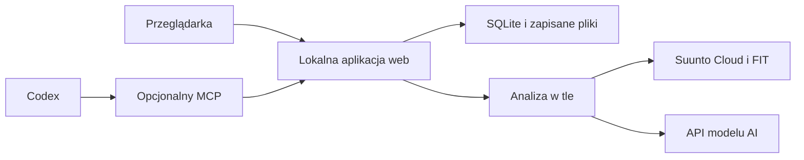

# Lokalna aplikacja web — plan rozwoju

Data rozmowy: 2026-11-13.

Status: zapis koncepcji użytkownika oraz rekomendacji po przeglądzie kodu i
dokumentacji z pięcioma subagentami. Dokument nie oznacza zatwierdzenia wszystkich
decyzji technicznych ani rozpoczęcia implementacji. Użytkownik poprosił o zapisanie
ustaleń, żeby wrócić do nich później.

## Koncepcja użytkownika

- Aplikacja uruchamiana lokalnie w Dockerze, obsługiwana przez przeglądarkę.
- Na stronie głównej lista 10 najnowszych aktywności z Suunto.
- Po otwarciu aktywności: szczegóły treningu, wykresy i podsumowanie analizy AI.
- W dalszym etapie informacje o zmęczeniu, odczuciach i gotowości treningowej.
- Możliwość przygotowywania podsumowań przez asystenta na podstawie dostarczonych
  metryk; rozważany interfejs MCP.

## Ocena wykonalności

Kierunek jest wykonalny jako kolejny interfejs do istniejącego silnika. Największa
praca dotyczy trwałego przechowywania wyników, synchronizacji oraz zadań w tle.
Obliczenia powinny pozostać wspólne dla CLI, web i adaptera MCP.

Pierwszy zakres produktu: jedna osoba i jedna lokalna instalacja. Docelowe
uruchomienie po początkowej konfiguracji: `docker compose up -d`, następnie lokalny
adres w przeglądarce. Dostęp z LAN, hosting publiczny i wiele kont to osobne,
późniejsze zakresy.

## Co istnieje w repozytorium

Stan sprawdzony podczas rozmowy, przed implementacją web:

| Element | Kod / zastosowanie |
| --- | --- |
| OAuth i odświeżanie tokenów | `suunto_cloud/authentication/`; logika do wykorzystania przez backend |
| Pobieranie aktywności i FIT | `suunto_cloud/downloads/` |
| Dekodowanie FIT | `suunto_cloud/fit/`; Node.js jest już w obrazie |
| Metryki, okrążenia, pauzy i mechanika | `suunto_cloud/analysis/fit.py`, `metrics.py` |
| Pakiet metryk dla analizy | `suunto_cloud/analysis/packet.py` |
| Raporty Markdown/JSON i SVG | `suunto_cloud/reporting/` |
| Synchronizacja CLI | `suunto_cloud/synchronization/service.py` |
| Docker i testy | Istniejący obraz, Compose i zestaw 71 testów w momencie przeglądu |

Repo nie ma obecnie serwera web, trwałej kolejki zadań, bazy aktywności,
generowania narracji przez model ani własnego adaptera MCP. Raport faktograficzny
z obecnego kodu nie jest podsumowaniem AI. Oficjalny Suunto MCP pozostaje osobną
integracją zewnętrznego klienta AI.

## Zmiany potrzebne w obecnej architekturze

1. Wydzielić operacje dla jednej aktywności: synchronizacja indeksu, zapewnienie
   FIT, dekodowanie, analiza, wykres i wygenerowanie podsumowania. Obecne `sync()`
   wybiera daty i nie jest gotowym procesem obsługi pojedynczego widoku treningu.
2. Wprowadzić trwałą ewidencję. Kolejne uruchomienia nadpisują wspólne pliki
   `.local/sync.json` i `.local/analysis.json`; atomowy zapis nie zapewnia historii
   ani izolacji równoległych zadań.
3. Katalogować dane według stabilnego klucza konta i aktywności. Data i godzina
   startu pozostają etykietą; nie powinny być jedynym kluczem artefaktów.
4. Sprawdzić i wdrożyć paginację, sortowanie oraz znaczenie filtrów dat Workout
   API. Obecny kod używa jednej strony `v2/workouts`; kompletność historii nie
   jest potwierdzona.
5. Dostosować retencję wykresów. Obecne sprzątanie wygenerowanych plików starszych
   niż 30 dni nie powinno usuwać bez wyjaśnienia historii dostępnej w aplikacji.
6. Oddzielić webowy OAuth od terminalowego `oauth.main()`, które korzysta z
   `getpass` i blokującego oczekiwania na callback. Na start można wykorzystać
   istniejącą konfigurację CLI i zapisane tokeny.

## Rekomendowana architektura

To propozycja do potwierdzenia przy wznowieniu prac:

- FastAPI nad istniejącym Pythonowym rdzeniem.
- React/TypeScript, budowany do plików statycznych serwowanych przez backend;
  frontend i API pod jednym origin.
- SQLite w trwałym lokalnym katalogu/wolumenie.
- Jeden worker wykonujący trwałe zadania; baza przechowuje status i etapy.
- Dwa serwisy Compose ze wspólnego obrazu: web i worker. Istniejący CLI zachować.
- Odczyt statusu zadania przez odpytywanie API; SSE ewentualnie później.
- Na start obecne SVG; interaktywne serie wykresów w kolejnym etapie.

Przykładowe rekordy: aktywności, artefakty, wersje analiz, zadania, próby wywołań
AI, podsumowania, odczucia i późniejsze codzienne check-iny. Prywatne dane pozostają
poza Gitem i obrazem Dockera; zachować dotychczasową lokalizację konfiguracji i
tokenów oraz istniejące raporty.

## Zakres pierwszej wersji użytkowej

| Ekran | Zawartość |
| --- | --- |
| Strona główna | 10 ostatnich aktywności, sport, data, dystans, czas, status analizy i odświeżenie |
| Szczegóły | Metryki, SVG, okrążenia, zapisane podsumowanie AI, notatka i odczucia |
| Ustawienia | Status połączenia, konfiguracja AI, jednostki, strefa czasowa, eksport i kopia danych |

Dziesięć aktywności to limit pierwszego widoku, nie limit przechowywania historii.
Na listę i zapisane wyniki nie czekamy do zakończenia synchronizacji.

Lista jest pobierana osobno od FIT. FIT pobieramy na żądanie; powtórne otwarcie
korzysta z zapisanych artefaktów. Osobne etapy to pobranie listy, FIT, obliczenia
i AI. Błąd jednego treningu albo AI nie blokuje innych danych.

Uwzględnić stany: brak aktywności, brak FIT, brak tętna, brak konfiguracji AI,
nieudane odświeżenie, wygasła autoryzacja oraz dostępna starsza wersja offline.
Pokazywać datę aktualności danych, bez udawania udanego odświeżenia.

Wykresy zachowują ustaloną preferencję: czas aktywny, bez pasm i oznaczeń pauz;
tętno delikatnie wygładzone średnią 15 s, z wizualnym łączeniem luk. Obliczenia
i AI używają danych źródłowych; brak pomiaru nie staje się zerem ani sztuczną próbką.

## Dwa sposoby analizy AI i rola MCP

| Sposób | Przebieg |
| --- | --- |
| Przycisk w aplikacji | Backend przekazuje przygotowany pakiet do API modelu i zapisuje wynik |
| Analiza w Codexie | Użytkownik prosi w rozmowie; agent odczytuje dane przez MCP i zapisuje wynik dla aplikacji |

MCP jest interfejsem do danych i kontrolowanych operacji. Sam nie zapewnia modelu
ani automatycznego uruchomienia aktualnej rozmowy po kliknięciu na stronie.
Dla współpracy z obecnym asystentem warto dodać go wcześnie. Do niezależnego
przycisku AI aplikacja potrzebuje własnego wykonawcy wywołującego model.

Proponowane narzędzia MCP:

- `list_workouts(limit=10)`.
- `get_workout_analysis(workout_id)`.
- `get_training_context(...)` dla jawnie wybranego, datowanego kontekstu.
- `save_ai_summary(workout_id, input_fingerprint, summary)`.

MCP korzysta z tych samych usług co web. Zapis przyjmuje identyfikator rekordu,
nie dowolną ścieżkę pliku; nie udostępniamy shella ani swobodnego odczytu katalogów.
Wynik dla starej wersji wejścia nie może nadpisać podsumowania nowych danych.

Rekomendacja pierwszego adaptera automatycznego AI: własny klucz API po stronie
backendu. Model dobrać po porównaniu jakości, opóźnienia i kosztu na kontrolowanych
przypadkach. Lokalny model można dodać później.

Dokumentacja sprawdzona podczas rozmowy opisuje również Sign in with ChatGPT dla
aplikacji lokalnych i open source, umożliwiające za osobną zgodą użycie planu
użytkownika do kwalifikujących się wywołań. To wariant preview do osobnego
sprawdzenia dostępności i ograniczeń. Nie zakładać, że aktualne logowanie Codexa
automatycznie autoryzuje aplikację; nie kopiować tokenów z konfiguracji Codexa.
Ponownie sprawdzić dokumentację przed implementacją.

## Kontrakt danych i podsumowania

Przygotować osobny, wersjonowany pakiet wejściowy z jawną listą pól. Obecny
`brief_packet()` zawiera również ścieżki plików i identyfikatory; nie wysyłać go
w całości do zewnętrznego modelu.

Wejście: metryki, okrążenia i istotne bloki, dostępność/pokrycie pomiarów, metoda
TSS, ograniczenia, wersja analizatora oraz wybrane odczucia i cel sesji. Porównania
muszą znać kryteria podobieństwa i kompletność dostępnej historii.

AI interpretuje wyliczone wartości. Wynik powinien zawierać:

1. Co zostało wykonane.
2. Najważniejsze obserwacje z odwołaniami do metryk lub odcinków.
3. Porównanie z podobnymi sesjami, jeżeli dane na to pozwalają.
4. Ograniczenia i rozróżnienie faktów od hipotez.

Stosować schemat odpowiedzi oraz walidację aplikacyjną. Poprawny JSON nie dowodzi
poprawności interpretacji. Zachować model/dostawcę, wersję promptu, język, czas
generacji i fingerprint wejścia. Zmiana metryk, kontekstu albo odczuć oznacza
nieaktualność poprzedniego opisu; poprzednią wersję można nadal zachować.

Nie generować AI przy każdym otwarciu strony. Osobne operacje odświeżania danych
i generowania opisu. Lokalny indeks i pliki pozostają na komputerze, ale analiza
modelem chmurowym przekazuje wybrane metryki poza komputer. Domyślnie pomijać GPS,
surowy FIT i dane konta. Kontekst wybierać świadomie; nie przekazywać automatycznie
całego prywatnego `TRAINING.md` ani historii rozmów.

## Odczucia, zmęczenie i przyszła gotowość

Prosta notatka i RPE po sesji powinny wejść wcześnie, aby zacząć zbierać kontekst.

| Pole | Znaczenie |
| --- | --- |
| Suunto `feeling` | Samopoczucie po sesji, 1–5, więcej oznacza lepiej |
| Własne RPE | Subiektywna trudność sesji na jawnie opisanej skali, np. 0–10 |
| Dzienne zmęczenie | Osobny wpis dotyczący konkretnego dnia |
| Cel sesji i jego realizacja | Intencja użytkownika, wykonanie i interpretacja to odrębne informacje |
| Check-in | Krótki wpis o śnie, stresie, odczuciach i chęci treningu |

Nie przeliczać automatycznie `feeling` na RPE. Każdy wpis ma datę, źródło i czas
wprowadzenia. Rekomendacja AI nie jest przyjętym planem użytkownika.

Dashboard początkowo pokazuje osobno: odczucia, ostatnie obciążenie, dostępne
pomiary snu/regeneracji oraz świeżość i kompletność danych. Własny wynik typu
„gotowość 82/100” odłożyć do opracowania i sprawdzenia jego zasad.

Robocza propozycja historii do trendów: 60–90 dni metadanych i dostępnych danych
24/7, z FIT pobieranymi na żądanie. To zakres produktu, a nie potwierdzone minimum
pozwalające wyznaczyć wiarygodny wynik gotowości.

Zasady interpretacji:

- Brak danych to brak danych, nie zero i nie potwierdzony dzień odpoczynku.
- Oddzielać niepobrany zakres od zakresu pobranego bez aktywności.
- Nie sumować alternatywnych TSS tego samego treningu.
- Zachować źródło i okres obowiązywania progów oraz stref.
- Nocne HR nie jest automatycznie tętnem spoczynkowym.
- Zasoby/regeneracja mają czas pomiaru; nie są stałą wartością całego dnia.
- Krótkie zmiany wskaźników nie dowodzą ich przyczyn ani gotowości medycznej.
- Daty lokalne, DST, sen nocny i drzemki wymagają spójnych zasad.

## Ustalenia o Suunto wymagające ponownej weryfikacji przy wdrożeniu

Publiczny opis Developer API podaje 10 wywołań/min i maksymalnie 200/tydzień.
Sprawdzić warunki rzeczywiście używanej subskrypcji. Cache, przyrostowa
synchronizacja i pobieranie FIT na żądanie są istotne dla budżetu wywołań.

Nowszy katalog API i dokumentacja webhooków obejmują sen oraz recovery. Przykłady
zawierają m.in. HRV snu, HR snu, `Balance` i `StressState`. Stare FAQ twierdzące,
że snu nie ma w Cloud API, jest niespójne z nowszym opisem. Nie obiecywać konkretnych
pól bez sprawdzenia uprawnień, jednostek i odpowiedzi danej aplikacji.

Oficjalny Suunto MCP dostępny w sesji asystenta nie staje się automatycznie
połączeniem dostępnym z lokalnego backendu. W aplikacji potrzebny jest jawny
adapter i własna autoryzacja źródła danych. Zachować rozróżnienie źródeł i łączyć
te same aktywności po identyfikatorach bez podwójnego liczenia.

## Bezpieczeństwo i niezawodność MVP

- Port hosta opublikowany tylko na loopback; UI i API na tym samym origin.
- Dozwolone Host/Origin i ochrona CSRF dla operacji zmieniających stan.
- Sekrety tylko w backendzie/workerze, poza Gitem i obrazem; nie w JavaScript,
  `localStorage`, odpowiedziach API ani logach.
- Nie serwować całego `.local/`; artefakty udostępniać przez konkretne rekordy.
- Zachować blokadę odświeżania tokenów i prywatne uprawnienia plików/bazy.
- OAuth: jednorazowy `state`, poprawny callback, bez kodów autoryzacji w logach.
- Tekst Suunto i AI renderować bez niekontrolowanego HTML.
- Trwałe zadania z kontrolą równoczesnego wykonania, timeoutami i limitem prób.
- Wielokrotne kliknięcie nie tworzy kilku identycznych aktywnych analiz.
- Po niejednoznacznym błędzie płatnego AI nie wykonywać ślepego auto-retry:
  dostawca mógł wykonać pracę przed utratą odpowiedzi. Zachować stan próby i
  identyfikatory odpowiedzi, jeżeli są dostępne.
- Błąd AI nie usuwa metryk i wykresów. Zamknięcie karty nie usuwa zadania.
- Kopie SQLite wykonywać spójną metodą wraz z potrzebnymi artefaktami; przetestować
  odtworzenie. Nie dodawać harmonogramu bez osobnej decyzji.

## Propozycje dalszych funkcji

1. Cel treningu i ocena wykonania zamierzonej pracy.
2. „Pokaż dlaczego” przy wniosku AI, z przejściem do wspierających danych.
3. Porównania podobnych sesji uwzględniające rodzaj treningu, teren i dostępne warunki.
4. Krótki codzienny check-in jako podstawa historii odczuć.
5. Widok tygodnia: objętość, intensywność i regularność z oznaczeniem braków.
6. Interaktywne wykresy: wspólny kursor, zoom i wybór okrążenia/odcinka.
7. Import lokalnego FIT bez wymagania działającego połączenia z API.
8. Historia wersji analiz, eksport i przenośna kopia danych.

Mapę trasy, rozbudowany czat, automatyczne plany, powiadomienia, wiele kont i
publiczny hosting odłożyć do osobnych decyzji po działającym MVP.

## Etapy i kryteria odbioru

| Etap | Wynik |
| --- | --- |
| 1. Krótki przegląd integracji / spike | Potwierdzona paginacja, kolejność i filtry aktywności, uprawnienia 24/7 oraz próbny kontrakt wejścia/wyjścia AI |
| 2. Trwały fundament | Baza, osobna analiza aktywności, cache i zadania odzyskiwane po restarcie |
| 3. Web | Lista 10, szczegóły, SVG, odświeżanie i dostęp do zapisanych wyników |
| 4. AI i MCP | Trwałe podsumowania, odczucia, kontrolowane wywołania modelu i współpraca z Codexem |
| 5. Trendy i regeneracja | Szersza historia, check-iny, porównania i transparentny dashboard sygnałów |

Pierwsza kompletna wersja użytkowa kończy się po etapie 4.

Główny test odbioru na sztucznych danych: lista → trening → wykres → podsumowanie
→ restart Dockera → zapisany wynik nadal dostępny.

Dodatkowo: brak sieci, brak HR/FIT, wygasła autoryzacja, błąd modelu, dwa kliknięcia
tej samej operacji, przerwanie zadania i odtworzenie kopii. Wynik dla nieaktualnego
fingerprintu nie może nadpisać nowszego. Zachować istniejące testy silnika i CLI.
Jakość AI sprawdzać na kontrolowanych przypadkach różnych sportów/struktur,
niepełnych pomiarów i różnych metod TSS.

## Punkt wznowienia rozmowy

Najpierw wrócić do etapu 1 i potwierdzić sposób wywoływania AI: automatyczny
przycisk z API modelu, analiza przez Codexa/MCP albo oba adaptery. Następnie
ustalić zakres pierwszej iteracji i dopiero rozpocząć implementację na osobnej
gałęzi, zachowując działający CLI. Brak ustalonego terminu i budżetu wdrożenia.

## Źródła sprawdzone podczas rozmowy

Informacje o API, planach i preview są zmienne; zweryfikować je ponownie przed
implementacją.

- [Suunto: katalog API](https://apizone.suunto.com/apis).
- [Suunto: limity produktów](https://apizone.suunto.com/products).
- [Suunto: webhooks i przykłady danych 24/7](https://apizone.suunto.com/webhooks).
- [Suunto: pola FIT, w tym feeling](https://apizone.suunto.com/fit-description).
- [OpenAI: Structured Outputs](https://developers.openai.com/api/docs/guides/structured-outputs).
- [OpenAI: Sign in with ChatGPT dla aplikacji OSS/lokalnych](https://developers.openai.com/siwc/token-sharing-open-source).
- [OpenAI: ograniczenia preview](https://developers.openai.com/siwc/token-sharing-open-source/preview-limitations).
- [OpenAI: kontrola danych API](https://developers.openai.com/api/docs/guides/your-data).
- [Codex: MCP](https://learn.chatgpt.com/docs/extend/mcp?surface=cli).
- [FastAPI: zadania w tle](https://fastapi.tiangolo.com/tutorial/background-tasks/).
- [FastAPI: TrustedHostMiddleware](https://fastapi.tiangolo.com/advanced/middleware/#trustedhostmiddleware).
- [SQLite: WAL](https://www.sqlite.org/wal.html) i [kopie bazy](https://www.sqlite.org/backup.html).
